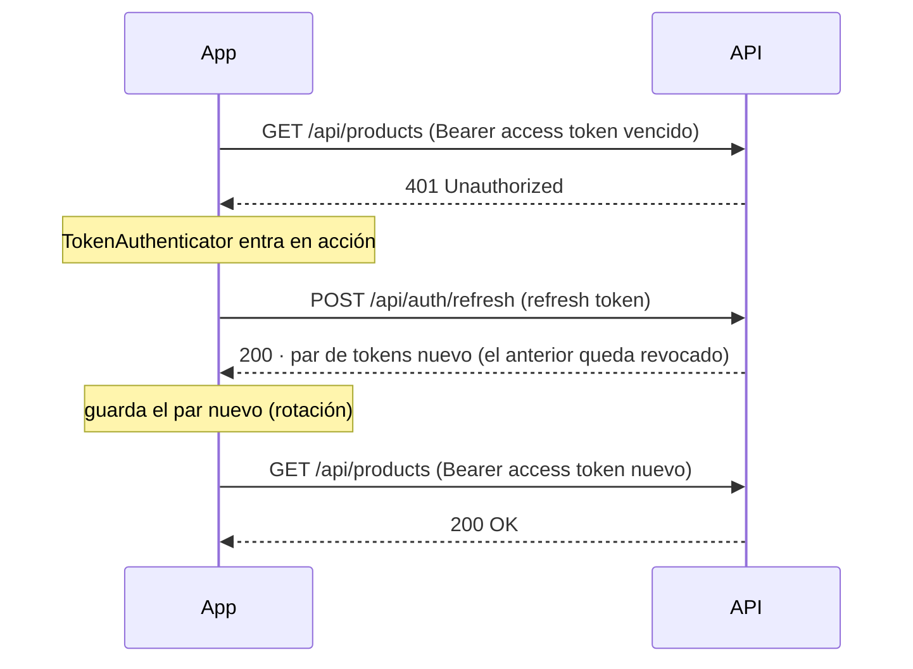

# EjemplosJWTAndroid

Ejemplo educativo de autenticación con **JSON Web Tokens (JWT)** en Android:
una app en **Kotlin + Jetpack Compose** que consume una API REST con login,
renovación de tokens con rotación, cierre de sesión y autorización por roles.

> La app **no firma ni verifica** tokens: la clave secreta solo existe en el
> servidor. El cliente se limita a guardar los tokens emitidos (cifrados con
> el Android Keystore), adjuntarlos a cada petición y renovarlos cuando
> expiran.

Funciona con **cualquiera de las APIs de ejemplo** de la serie, porque las tres
implementan el mismo contrato (`access_token`/`refresh_token`/`expires_in`, rol
en el claim `role`, `/api/auth/me`, productos con `id`, `name`, `description` y
`price`): PHP (puerto 8000), Java (8080) o .NET (5274).

## Endpoints que consume

| Método | Ruta                   | Uso en la app                                            |
| ------ | ---------------------- | -------------------------------------------------------- |
| POST   | `/api/auth/login`      | Pantalla de login: canjea credenciales por tokens         |
| POST   | `/api/auth/refresh`    | Automático ante un 401 y manual con “Renovar tokens”      |
| POST   | `/api/auth/logout`     | Botón “Cerrar sesión”: revoca el refresh token (sin access token) |
| GET    | `/api/auth/me`         | Pestaña Sesión: claims del usuario autenticado            |
| GET    | `/api/products/public` | Pantalla inicial (sin sesión) y pestaña Productos          |
| GET    | `/api/products`        | Pestaña Productos, catálogo completo (requiere token)     |
| POST   | `/api/products`        | Pantalla “Nuevo producto” (solo rol Admin)                |

## El flujo central: renovación automática ante un 401



Si el refresh también falla (token revocado o expirado), la app borra la
sesión local y vuelve sola a la pantalla de login. Este flujo está cubierto
por tests unitarios con un servidor HTTP falso (MockWebServer).

Toda renovación (la automática ante un 401 y la del botón “Renovar tokens”)
pasa por un único `TokenRefresher` con un lock: con rotación de refresh
tokens, dos canjes simultáneos del mismo token harían que el servidor lo
detectara como robo y revocara todas las sesiones del usuario.

El **logout** va por el cliente HTTP *plano*, sin access token: el refresh
token es la credencial. Si fuera por el cliente autenticado y el access token
hubiera expirado, el 401 dispararía una renovación que rotaría el refresh
token, y el logout revocaría el viejo dejando vivo el nuevo.

## Estructura

El código separa la autenticación JWT de los productos, de las vistas y de
la configuración de Android:

```
com.carlosalbertoxw.ejemplos_jwt_android/
├── App.kt, MainActivity.kt   Configuración Android, cableado (AppContainer)
│                             y navegación (Navigation Compose)
├── auth/                     Todo lo relativo a JWT — sin nada de UI
│   ├── AuthApi.kt            login/refresh/logout (cliente plano) y me
│   ├── AuthModels.kt         LoginRequest, TokenPair, Me, Session…
│   ├── SessionStorage.kt     Contrato de almacenamiento (testeable con fakes)
│   ├── TokenStore.kt         Implementación: DataStore + caché en memoria
│   ├── TokenCipher.kt        Cifra los tokens con una clave del Keystore
│   ├── AuthInterceptor.kt    Adjunta "Authorization: Bearer …"
│   ├── TokenRefresher.kt     Único punto de renovación (lock compartido)
│   ├── TokenAuthenticator.kt Renovación automática ante un 401 (rotación)
│   ├── JwtDecoder.kt         Lee el payload del JWT (sin verificar firma)
│   └── AuthRepository.kt     Fachada: lo único que la UI conoce de auth
├── products/                 Recurso de productos — no sabe nada de JWT
│   ├── ProductsApi.kt        Catálogo público, completo y alta
│   ├── ProductModels.kt      Product, NewProduct
│   └── ProductsRepository.kt Fachada del recurso
├── core/                     Utilidades compartidas
│   ├── ApiFailure.kt         Errores de la API como datos + apiResult
│   └── MoshiProvider.kt      Instancia única de Moshi (adaptadores generados con KSP)
└── ui/                       Pantallas Compose y sus ViewModels
    ├── PublicCatalogScreen   Primera pantalla: catálogo sin sesión
    ├── LoginScreen
    ├── HomeScreen            Pestañas Sesión y Productos (pull-to-refresh)
    ├── CreateProductScreen   Alta de productos (solo Admin)
    ├── ProductListCard       Lista compartida por ambos catálogos
    └── UiMessages.kt         Traduce errores/mensajes a strings.xml
```

Los ViewModels solo hablan con los repositorios; el paquete `products` usa
el cliente HTTP autenticado sin saber que existe JWT, porque el interceptor
y el authenticator del paquete `auth` adjuntan y renuevan los tokens de
forma transparente. El único lugar donde los paquetes se conocen entre sí
es `AppContainer`.

## Cómo ejecutarlo

1. Arranca cualquiera de las APIs de ejemplo (PHP en el puerto 8000, Java en
   el 8080 o .NET en el 5274). Para probar desde un dispositivo físico debe
   escuchar en `0.0.0.0` (todas las interfaces), no solo en `localhost`.
2. Configura la URL base **sin tocar el código**, con la propiedad de Gradle
   `apiBaseUrl` (se inyecta como `BuildConfig.BASE_URL`):

   ```properties
   # gradle.properties
   apiBaseUrl=http://192.168.1.75:8000/
   ```

   - **Emulador**: `http://10.0.2.2:8000/` (el localhost de tu PC visto
     desde el emulador) — es el valor por defecto, definido en
     [app/build.gradle.kts](app/build.gradle.kts). Cambia el puerto según la
     API (8080 Java, 5274 .NET).
   - **Dispositivo físico**: la IP de tu PC en la red local (teléfono y PC
     en la misma red), p. ej. `http://192.168.1.75:8000/`.

   Si usas una IP, añádela también a
   [network_security_config.xml](app/src/debug/res/xml/network_security_config.xml):
   el tráfico HTTP en claro solo está permitido hacia los hosts de
   desarrollo listados ahí, y **solo en las compilaciones debug**.
3. Al abrir la app se muestra el catálogo público (sin precios). Con
   **Iniciar sesión** entra con los usuarios de prueba:
   `admin / Admin123!` (rol Admin) o `user / User123!` (rol User).
   Las listas se refrescan arrastrándolas hacia abajo (*pull-to-refresh*).

## Tests

```
./gradlew :app:testDebugUnitTest   # pruebas unitarias
./gradlew :app:lintDebug           # Android Lint (falla ante cualquier aviso)
```

- `TokenAuthenticatorTest` — el flujo 401 → refresh → reintento con un
  servidor HTTP falso (MockWebServer): renovación exitosa, refresh fallido
  (borra la sesión), límite de un reintento (sin bucles) y sin sesión.
- `TokenRefresherTest` — varias renovaciones simultáneas del mismo token
  hacen un solo canje en el servidor; un refresh rechazado borra la sesión y
  un error de red la conserva.
- `JwtDecoderTest` — decodificación del payload Base64Url de un JWT.

## Notas de seguridad

Este es un proyecto educativo; aun así aplica varias prácticas reales:

- Los tokens se persisten **cifrados** con una clave AES/GCM del Android
  Keystore ([TokenCipher.kt](app/src/main/java/com/carlosalbertoxw/ejemplos_jwt_android/auth/TokenCipher.kt)):
  la clave no puede extraerse del dispositivo.
- `allowBackup="false"` más reglas de respaldo y de extracción de datos
  (Android 12+): los tokens no salen del dispositivo ni en los respaldos en
  la nube ni en la transferencia a otro teléfono.
- El tráfico HTTP en claro está **restringido a los hosts de desarrollo y
  solo en debug** ([src/debug](app/src/debug)); el APK de release no tiene esa
  excepción, así que su API debe ir por HTTPS.
- El APK de release se compila con **R8** (código reducido y ofuscado).
- El log de peticiones (que incluye los tokens, útil para estudiar el
  flujo en Logcat) solo existe en compilaciones **debug**; en release no se
  registra nada.

## Solución de problemas

- **“No se pudo conectar con el servidor”** en el teléfono físico:
  - Verifica que la API escuche en `0.0.0.0`, no en `localhost`.
  - El Firewall de Windows puede bloquear conexiones entrantes al puerto
    8000: permite el puerto o la aplicación del servidor.
  - Teléfono y PC deben estar en la misma red Wi-Fi, y la IP de
    `apiBaseUrl` debe ser la actual de tu PC (`ipconfig`) y estar en
    `app/src/debug/res/xml/network_security_config.xml`.
- **Funciona en el emulador pero no en el teléfono** (o al revés): revisa
  que la URL de `apiBaseUrl` corresponda al caso (10.0.2.2 vs IP local) y
  que el host esté en `network_security_config.xml`.
- **429 Demasiados intentos** al hacer login: la API limita los intentos
  fallidos; espera los segundos que indica el mensaje (encabezado
  `Retry-After`).
- **La sesión “se cierra sola”**: es el comportamiento esperado cuando el
  refresh token expira o fue revocado (p. ej. reutilización detectada tras
  la rotación): la app borra la sesión y vuelve al login.

## Stack

Kotlin 2.4 · AGP 9.5 (Kotlin integrado) · Gradle 9.9 · Jetpack Compose (BOM
2026.09) · Retrofit 3 · OkHttp 5 · Moshi con KSP · DataStore · compileSdk 37.

## Licencia

[MIT](LICENSE).
